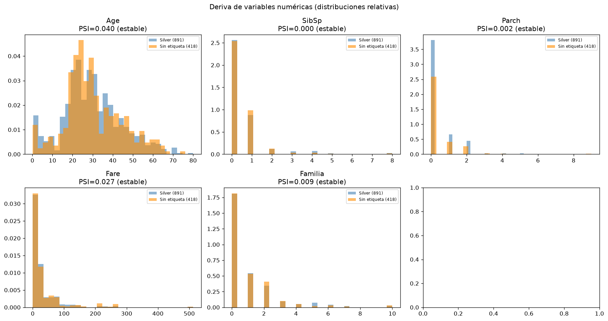
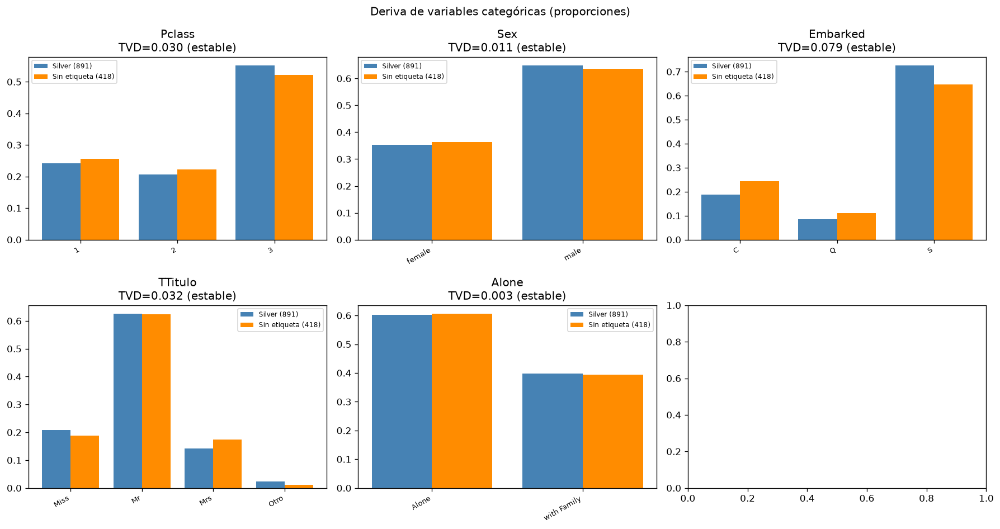
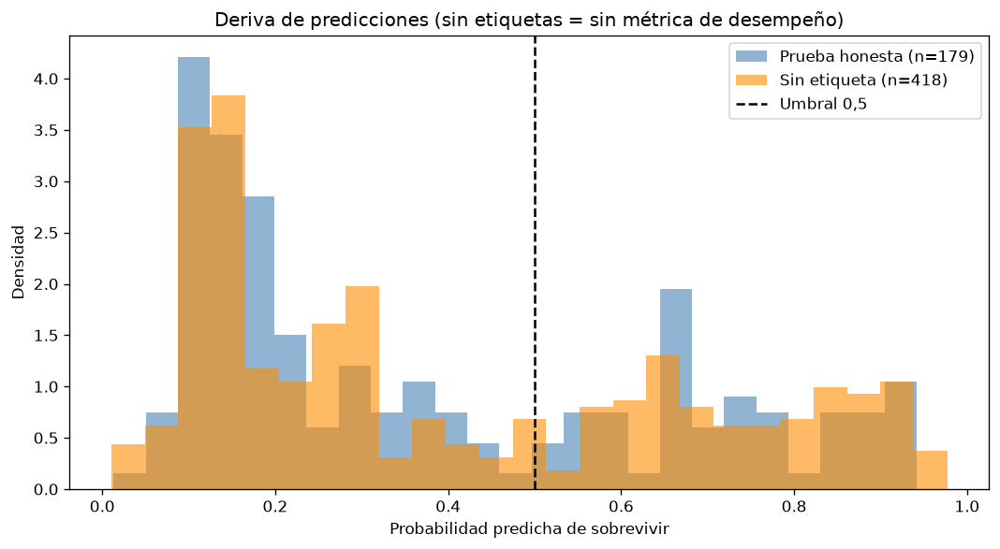

# Validación externa y deriva — cohorte sin etiqueta

**Generado:** 2026-11-23T06:53:14.647910+00:00 · **Comando:** `make validar-externa`

## Alcance (leer antes que las cifras)

Se cargan los **418 pasajeros sin etiqueta** de `data/bronze/titanic_unlabeled.csv` (SHA-256 `1f9d38185f84…`), que nunca entraron en el entrenamiento, y se puntúan con el modelo guardado `models/titanic_model_v1.joblib` (SHA-256 `f8aa74fd2afc…`).

> **No hay validación de desempeño.** Al no existir `Survived` en esta cohorte no se puede calcular exactitud, recall ni ROC-AUC, y **no** se reabre la métrica de prueba. Lo que sigue es *monitorización de deriva*: ¿se parece la cohorte nueva a la de entrenamiento en sus entradas y en las predicciones?

Referencia: 891 pasajeros etiquetados de Silver. Las probabilidades de «prueba honesta» están **congeladas** en `evaluacion_prueba.json` (evaluación única sobre 712 entrenamiento y 179 prueba, hecha por `make holdout`); este informe no las recalcula ni reabre la métrica final. La columna «in-sample» usa el modelo definitivo sobre los 891 y es optimista: solo contexto.

## Variables numéricas

| Variable | Media ref. | Media ext. | PSI | KS p-valor | Faltantes ext. | Señal |
|---|---:|---:|---:|---:|---:|---|
| `Age` | 29.70 | 30.27 | 0.040 | 0.702 | 20.6 % | estable |
| `SibSp` | 0.52 | 0.45 | 0.000 | 0.991 | 0.0 % | estable |
| `Parch` | 0.38 | 0.39 | 0.002 | 1 | 0.0 % | estable |
| `Fare` | 32.20 | 35.63 | 0.027 | 0.751 | 0.2 % | estable |
| `Familia` | 0.90 | 0.84 | 0.009 | 0.999 | 0.0 % | estable |

*Figura 1.* Las barras azules son la cohorte etiquetada; las naranjas, la cohorte sin etiqueta. Un desplazamiento visible con PSI alto indica que el modelo podría estar puntuando un perfil poco frecuente en entrenamiento. El p-valor de KS es sensible al tamaño muestral: se lee junto al PSI y a la figura, no aislado.

## Variables categóricas

| Variable | TVD | Categorías nuevas | Faltantes ext. | Señal |
|---|---:|---|---:|---|
| `Pclass` | 0.030 | — | 0.0 % | estable |
| `Sex` | 0.011 | — | 0.0 % | estable |
| `Embarked` | 0.079 | — | 0.0 % | estable |
| `TTitulo` | 0.032 | — | 0.0 % | estable |
| `Alone` | 0.003 | — | 0.0 % | estable |

*Figura 2.* Proporciones por categoría. La distancia de variación total (TVD) es la mitad de la suma de diferencias absolutas: 0 sería idéntica, 1 no solapada. Las categorías nuevas se absorben con `handle_unknown="infrequent_if_exist"`, pero conviene vigilarlas: el modelo no aprendió su efecto.

## Predicciones

| Métrica | Prueba honesta (179) | Sin etiqueta (418) | In-sample (891) |
|---|---:|---:|---:|
| Probabilidad media | 0.375 | 0.403 | 0.384 |
| Tasa predicha positiva (umbral 0.5) | 0.335 | 0.376 | 0.345 |

Tasa real de supervivencia en entrenamiento: 0.384. Predicciones con NaN: **0**. La cohorte sin etiqueta no permite saber si esas predicciones son correctas: solo permite comparar la distribución con la de un conjunto donde sí conocemos la respuesta.

*Figura 3.* Si la curva naranja se desplaza de la azul, cambió la mezcla de perfiles (deriva de covariables) o el modelo está extrapolando. No dice nada sobre aciertos.

## Conclusión y límites

Señales fuera del rango «estable» (PSI/TVD ≥ 0.10): **ninguna supera el umbral de 0,10**.

- Los umbrales 0,10 / 0,20 son una **heurística de cribado**, no un contrato: con 418 filas, variaciones pequeñas pueden ser ruido y variaciones grandes pueden ser cambios legítimos de composición (por ejemplo, más pasajeros de 3.ª clase).
- Bronze sin etiqueta pertenece al **mismo viaje** y a la misma fuente que el entrenamiento: es una cohorte de inferencia, no una validación temporal ni un dataset de otro naufragio. No demuestra transferibilidad.
- Las transformaciones se reutilizan de `flows/01_data_engineering.py` y la imputación ocurre dentro del pipeline guardado: no se filtraron estadísticas de la cohorte nueva hacia el entrenamiento.
- Si la deriva es «alta», el siguiente paso es investigar la fuente del cambio y reentrenar **con etiquetas nuevas**; ajustar el modelo contra esta cohorte sin etiquetas no es posible y sería metodológicamente incorrecto.

Detalles serializables (todas las cifras, hashes y umbrales): `validacion_externa.json`. Figuras: `figuras/`.
