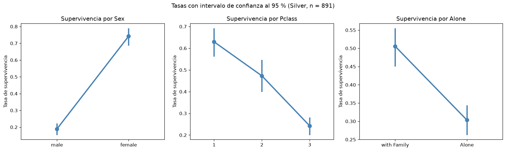
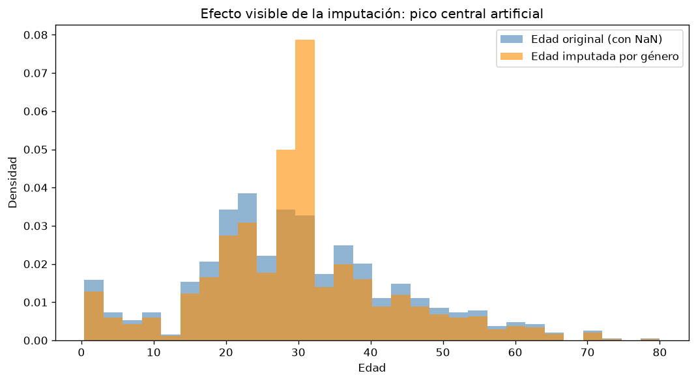
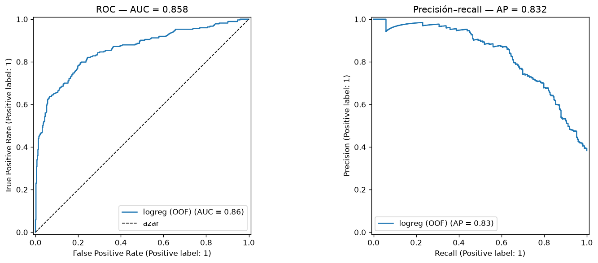
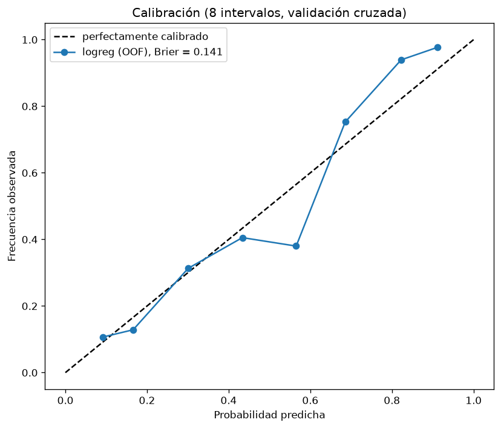
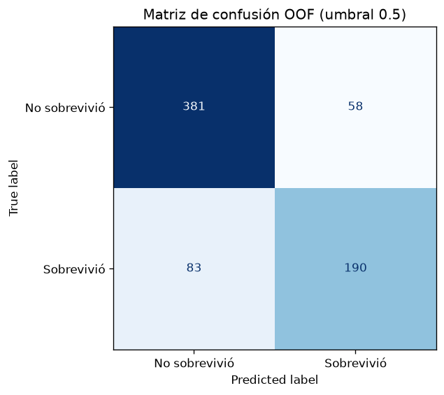

# Validación gráfica de EDA y modelo

**Generado:** `make figuras` · Figuras en `figuras/`. Las imágenes no son capturas manuales: se regeneran desde Silver y desde el pipeline congelado.

## 1. Los hallazgos del EDA, vistos con incertidumbre

*Figura 1.* Puntos = tasa de supervivencia; barras = intervalo de confianza al 95 %. Confirma visualmente la gradiente por clase, la ventaja femenina y que viajar acompañado se asocia con más supervivencia. Las barras más anchas (pocos casos) son la advertencia: no hay que leer diferencias pequeñas como reglas.

*Figura 2.* Comparar la edad original con la imputada revela un pico central que no estaba en los datos: 177 edades se rellenaron con promedios por género. Es el resultado esperado de la decisión de limpieza, y por eso el modelo usa `AgeOriginal` y vuelve a imputar dentro del `Pipeline`.

## 2. Validación del modelo sin reabrir la prueba

Las tres figuras siguientes usan **712 predicciones fuera de pliegue** (5 pliegues sobre los 712 de entrenamiento). El conjunto de prueba de 179 sigue intocable: sus cifras están en `model_card.md`.

*Figura 3.* ROC (AUC OOF = **0.858**) y precisión–recall (AP = **0.832**). La curva PR es la más informativa con un 38 % de positivos: muestra el compromiso entre encontrar sobrevivientes y no desperdiciar predicciones positivas.

*Figura 4.* Calibración por intervalos (Brier = **0.141**). Si los puntos se apartan de la diagonal, la probabilidad no debe leerse como una frecuencia empírica. Es una comprobación gráfica del Brier reportado en la ficha.

*Figura 5.* Errores a umbral 0.5. Permite ver los falsos negativos y positivos que la exactitud global esconde, y coincide con la lectura por subgrupos de `problema_ml.md`: el modelo reproduce la desigualdad histórica.

## 3. Deriva

La validación sobre los 418 pasajeros sin etiqueta y sus figuras están en `validacion_externa.md`. Recuérdese que allí **no hay métrica de desempeño**: solo cuando hay etiquetas se puede medir aciertos; esa cohorte solo permite vigilar deriva.
